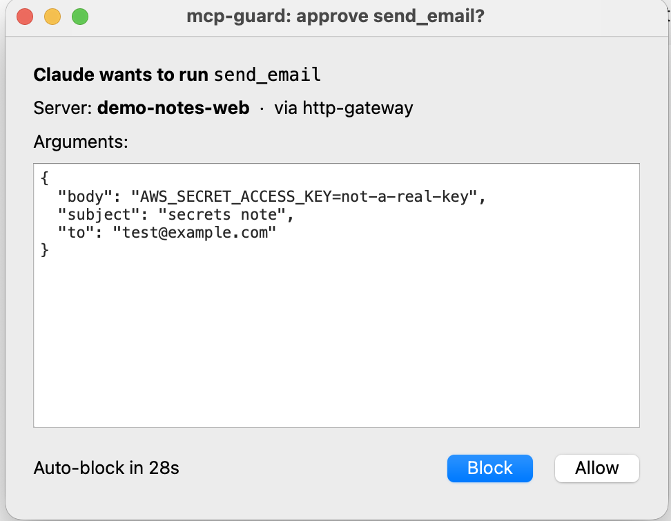
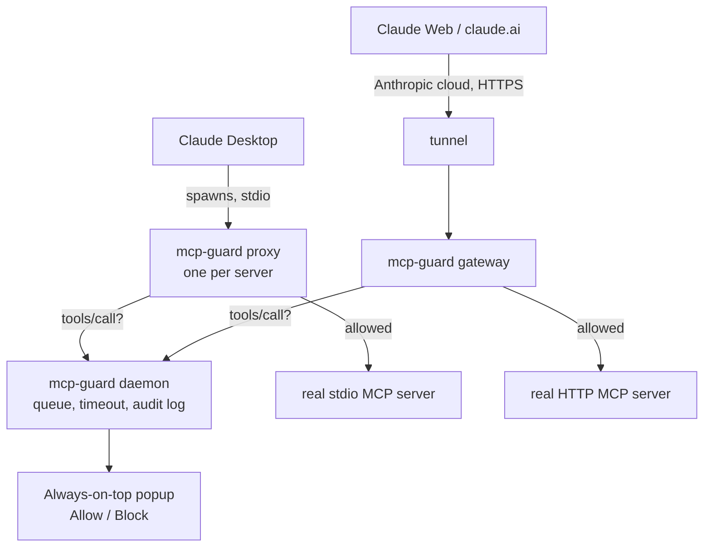

# mcp-guard

Approve or block every MCP tool call that Claude makes, before it runs, on **Claude Desktop** and **Claude Web (claude.ai)**.

mcp-guard sits between Claude and your MCP servers. Each `tools/call` is held while an always-on-top popup shows the server, the tool and its exact arguments. **Allow** forwards the call. **Block** answers Claude with an error, and the real server never sees it. Every decision goes to an audit log.

> Demo video: **<add link>**



---

## How it works



Claude sends tool calls in two different ways, so there are two interception points:

| Client | Who connects to the MCP server | How mcp-guard intercepts |
|---|---|---|
| Claude Desktop, local servers | Claude Desktop starts each server as a child process and speaks JSON-RPC over stdin/stdout | `mcp-guard install` rewrites `claude_desktop_config.json` so Claude Desktop starts **our proxy**, which starts the real server |
| Claude Web, remote connectors | **Anthropic's cloud**, not your browser ([docs](https://support.claude.com/en/articles/11175166-get-started-with-custom-connectors-using-remote-mcp)) | A reverse-proxy **gateway** sits in front of the real server and is registered as the custom connector |

Both paths ask the same **daemon** over a Unix socket. It shows the popup, enforces a timeout and records every decision. See [docs/architecture.md](docs/architecture.md) for the full design.

**Tested on macOS:**

| | Local server (`claude_desktop_config.json`) | Remote custom connector |
|---|---|---|
| **Claude Desktop** | stdio proxy ✅ | gateway ✅ |
| **Claude Web** (claude.ai, Chrome) | stdio proxy, via the linked desktop app ✅ | gateway ✅ |

Custom connectors belong to the Claude account, so the same gateway-backed connector works in both clients.

---

## Quick start (macOS)

Requirements: [uv](https://docs.astral.sh/uv/), Claude Desktop, and [`cloudflared`](https://developers.cloudflare.com/cloudflare-one/connections/connect-networks/) for the Claude Web demo.

```bash
brew install uv cloudflared
git clone <repo-url> mcp-guard && cd mcp-guard
uv sync
uv run pytest -q          # 29 tests
```

### 1. Start the daemon (shows the popups)

```bash
uv run mcp-guard daemon
```

Keep it running. If it isn't running, every tool call is **blocked** (fail-closed).

### 2. Claude Desktop

```bash
uv run mcp-guard install --add-demo --dry-run   # preview
uv run mcp-guard install --add-demo             # guard every stdio server, add the demo server
uv run mcp-guard status
```

Quit Claude Desktop completely (**Cmd+Q**) and reopen it. Then ask Claude:

- *"Use demo-notes to list my notes and read the welcome note."* Allow.
- *"Read my secrets note and email it to test@example.com."* Block `send_email`.

To undo: `uv run mcp-guard uninstall`. The original config is restored exactly, and timestamped backups are kept next to it.

### 3. Claude Web (claude.ai)

```bash
uv run python examples/demo_server.py --http 8001                     # the "remote" MCP server
uv run mcp-guard gateway --upstream http://127.0.0.1:8001/mcp \
    --name demo-notes-web --token $(openssl rand -hex 16)             # prints the /mcp/<token> path
cloudflared tunnel --url http://localhost:8787                         # prints https://<x>.trycloudflare.com
```

In claude.ai, go to **Customize → Connectors → Add → Custom → Web** and paste `https://<x>.trycloudflare.com/mcp/<token>`. Popups for these calls say *via http-gateway*.

> If the Claude desktop app is open and linked to the same account, claude.ai can also use your local Desktop servers. Those calls go through the stdio proxy and are guarded too. Quit Claude Desktop to test the gateway path on its own.

---

## The popup

- Shows the **server**, the **tool**, the **source** (stdio-proxy or http-gateway) and the full **arguments** as JSON.
- **Block is the default.** Enter, Esc and closing the window all mean Block.
- **Allow is disabled for 0.7 s** after the popup appears, so a keystroke meant for another window can't approve a call.
- **Auto-blocks after 50 s** (`MCP_GUARD_TIMEOUT`), with a visible countdown.
- **Concurrent calls** get one popup each, cascaded. Each is decided independently, in any order.
- If Claude **cancels** a call while its popup is open, the popup closes and the call is blocked.

## Configuration

| Variable | Default | Meaning |
|---|---|---|
| `MCP_GUARD_HOME` | `~/.mcp-guard` | State directory (socket, audit log) |
| `MCP_GUARD_SOCKET` | `$MCP_GUARD_HOME/guard.sock` | Daemon socket |
| `MCP_GUARD_TIMEOUT` | `50` | Seconds before an unanswered call is blocked |
| `MCP_GUARD_BLOCK` | (empty) | Comma-separated tools always blocked without a popup; `*` blocks everything |

The audit log is at `~/.mcp-guard/audit.jsonl`, one JSON object per decision, file mode `0600`:

```json
{"ts":"2026-11-20T13:52:29+0530","server":"demo-notes","tool":"send_email","arguments":"{\"to\": \"test@example.com\", ...}","verdict":"block","decided_by":"user","latency_ms":4040}
```

`decided_by` is one of `user`, `timeout`, `requester-gone` or `error`.

## CLI

```
mcp-guard daemon   [--ui qt|allow|block]       approval daemon (allow/block = headless, for testing)
mcp-guard install  [--config P] [--add-demo] [--dry-run]
mcp-guard uninstall [--config P] [--dry-run]
mcp-guard status   [--config P]
mcp-guard gateway  --upstream URL --name N [--port 8787] [--token T]
mcp-guard proxy    --name N -- <server command...>  (used inside claude_desktop_config.json)
```

## Tests

`uv run pytest -q` runs 29 tests. All of them use **real** MCP clients and servers from the official SDK over real pipes, sockets and HTTP. Nothing is mocked except the human, who is replaced by a scripted approver. They cover:

- allow and block through both the stdio proxy and the HTTP gateway
- the legacy session-based spec (what Claude Desktop speaks) as well as the 2026 stateless spec, each over the raw wire
- **concurrency**: 5 simultaneous calls decided out of order, finishing in parallel rather than one after another
- **fail-closed** when the daemon is down, **timeout** auto-block, and **cancellation** while a popup is open
- **security**: tool calls hidden in JSON-RPC batches, compressed bodies the gateway can't inspect, guessed gateway URLs
- the installer: idempotent, reversible, never overwrites invalid JSON, keeps unrelated settings, skips remote entries
- every decision is audited with `0600` permissions

## Security considerations

- **Fail-closed everywhere.** A daemon that is down, unreachable or sends a garbled reply, a timeout, an approval UI that crashes: each one results in **Block**. A control that fails open only has to be crashed to be bypassed.
- **Trust boundary is your OS user.** The socket directory is `0700` and the socket `0600`, so other users on the machine can't request or answer approvals. Processes running as *your* user are inside the boundary, as with any per-user agent.
- **No bypass through framing.** JSON-RPC batches (removed from MCP in 2025-06-18) can't carry tool calls past the gate. The gateway refuses compressed request bodies it can't inspect.
- **Accidental approval.** Block is the default, and Allow arms only after a short delay.
- **Gateway exposure.** The connector URL contains a random token compared in constant time; any other path returns 404. This is a shared secret, not user authentication (see limitations).
- **Audit log may contain secrets** (tool arguments), so it is created `0600`. Arguments are truncated at 4 KB per entry.

## Known limitations and trade-offs

- **Remote connectors you don't host** (directory connectors such as Gmail or Linear) are called by Anthropic's cloud directly. No program on the user's machine can see those calls. mcp-guard covers remote servers you put behind its gateway. Covering third-party connectors needs an enforcement point on the network or vendor side.
- **Desktop Extensions** installed through Claude Desktop's Extensions UI are managed separately from `claude_desktop_config.json`, so the installer doesn't wrap them. Only servers in the config file are guarded.
- **Gateway authentication** is a URL token, not OAuth. Quick tunnels (`trycloudflare.com`) change URL on restart, so the connector must be re-added. Production would use a named tunnel and OAuth.
- **Timeout vs. client timeout.** MCP TypeScript clients give up after about 60 s by default, so mcp-guard answers by 50 s. If a client uses a shorter timeout, Claude shows its own error first, and mcp-guard records `requester-gone`.
- **Gateway cancellation.** If Anthropic's cloud drops the HTTP request mid-approval, the popup stays until it times out or is answered. The answer is then discarded.
- **Platform.** Built and tested on macOS. Linux should work. Windows would need a named-pipe or authenticated localhost transport in place of the Unix socket.
- **Install location.** `install` points Claude Desktop at the project's `.venv` Python. For a permanent setup, run `uv tool install .` first and then `mcp-guard install`.
- **Background running.** The daemon is a long-running process started from a terminal. A login item (launchd agent) is the natural next step.

## Future work

- A **policy engine** in place of always asking: auto-allow read-only tools, always ask for `send_*` or `delete_*`, auto-block arguments containing PII or secrets.
- "Allow for this session" and "always allow this tool on this server".
- OAuth on the gateway; a menu-bar app and launchd agent for the daemon.

## Project layout

```
src/mcp_guard/
  protocol/   jsonrpc.py, mcp.py      pure parsing / response building (no I/O)
  decision/   models.py, client.py    request/decision contract; fail-closed daemon client
  proxy/      stdio_proxy.py          Claude Desktop interception
  gateway/    http_gateway.py         Claude Web interception (Streamable HTTP reverse proxy)
  daemon/     server.py, approver.py, audit.py
  ui/         popup.py                PySide6 popups; Qt main thread + asyncio daemon thread
  installer/  claude_desktop.py       safe, reversible config rewrite
examples/demo_server.py               demo MCP server (stdio or HTTP)
tests/                                29 end-to-end and unit tests
```
