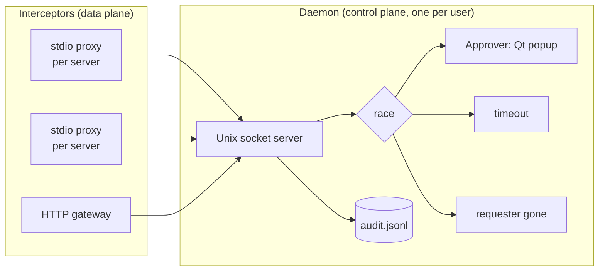
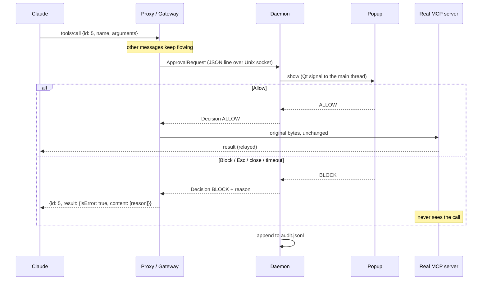

# mcp-guard: architecture

## 1. Goal and the main constraint

The goal is to let a human approve or block each MCP tool call made by Claude Desktop and Claude Web, before it executes.

mcp-guard does **not** modify or hook into Claude. Claude is a closed client, and its tool calls are plain JSON-RPC 2.0 messages (`tools/call`) sent to an MCP server. Anything that sits on that connection and speaks the protocol can decide which messages reach the server. So the design question is **where the connection is reachable**:

| Path | Who opens the connection | Where we can sit |
|---|---|---|
| Claude Desktop, local server | Claude Desktop spawns a child process; JSON-RPC over stdin/stdout | Between Claude Desktop and the child process |
| Claude Web / remote connector | Anthropic's cloud, over HTTPS to a public URL | In front of the server, at that URL |
| Claude Web using local servers through a linked desktop app | Claude Desktop, as above | Same as the first row (covered by the same proxy) |
| Claude Desktop using a remote custom connector | Anthropic's cloud (connectors belong to the account, not the app) | Same as the Web row (covered by the same gateway) |

### Alternatives considered and rejected

- **Browser extension on claude.ai.** Connector calls run in Anthropic's cloud, so the browser never sees them, and it has nothing to hold or block.
- **Local network sniffing or TLS interception.** Same problem for Web. For Desktop the transport is pipes, not the network.
- **Patching or injecting into Claude Desktop.** Fragile across updates, and an inappropriate thing for a security product to do to someone else's app.
- **Asking Claude via the system prompt.** Not enforcement: the model can be prompt-injected, which is the threat we're defending against.

## 2. Components

- **One codebase, several processes**: a modular monolith with a sidecar model. Claude Desktop forces one process per MCP server, so each server gets its own lightweight proxy. All decisions, UI and audit live in one daemon, so there's one queue, one log and one set of popups.
- **`protocol/`** is pure: parsing and response building with no I/O, which makes it fully unit-testable.
- **`decision/client.py`** is the single function both interceptors call. Adding the HTTP path didn't change any decision logic.
- **`daemon/approver.py`** defines an `Approver` protocol. The Qt popup is one implementation; tests use a scripted one. A policy engine would be another.

## 3. Request lifecycle

**Why a tool error and not a JSON-RPC error.** A blocked call returns a normal result with `isError: true`. Claude passes that text to the model, which then tells the user the call was blocked and why. A protocol-level `error` tends to show up as a generic failure.

## 4. Concurrency

- **Proxy.** Two pump tasks run for the life of the connection: client→server and server→client. When a `tools/call` arrives, the pump **does not await** the decision. It spawns a gate task and keeps reading. A popup waiting on a human therefore never stalls pings, `tools/list`, responses or other tool calls. Writes from different tasks to the same pipe are serialised by an `asyncio.Lock` per direction, so JSON lines never interleave.
- **Daemon.** One socket connection per pending call. `asyncio.start_unix_server` handles each connection in its own task. For each request, the daemon races three outcomes with `asyncio.wait(FIRST_COMPLETED)`:
  - the approver answers
  - the requester disconnects (Claude cancelled, or the proxy died)
  - the timeout fires

  The losers are cancelled. Cancelling the approver closes its popup.
- **Proof.** `test_concurrent_calls_decided_out_of_order` sends 5 simultaneous calls with different delays and verdicts. All are answered correctly in about the time of the slowest one, not the sum.

## 5. Threading: Qt and asyncio

Qt must own the main thread, and asyncio objects belong to their loop's thread. The daemon's asyncio loop therefore runs in a background thread. There are exactly two crossings:

- asyncio → Qt: `Signal.emit(...)` on a `QObject` that lives in the main thread. Qt queues the call onto the main thread.
- Qt → asyncio: `loop.call_soon_threadsafe(future.set_result, verdict)`.

No widget is touched off the main thread, and no asyncio object is touched off its loop.

## 6. Protocol versions

MCP has two shapes in the wild, and a proxy that writes its own responses must match the shape of the request it answers:

- **Session-based (≤ 2025-11-25)**, used by Claude Desktop today: `initialize` handshake, version fixed per session. Strict TypeScript clients reject unknown result keys.
- **Stateless (2026-07-28)**: no handshake. Each request carries its version in `params._meta["io.modelcontextprotocol/protocolVersion"]`, and results must include `resultType: "complete"`.

`make_blocked_result()` reads the version from the request itself (or from the `MCP-Protocol-Version` header on HTTP) and adds `resultType` only when required. There's a test for each shape, including a raw-wire test of the legacy handshake.

## 7. Failure modes

| Failure | Behaviour | Test |
|---|---|---|
| Daemon not running / socket refused | Block, with "daemon is not running" | `test_daemon_down_fails_closed` |
| Human doesn't answer | Block after `MCP_GUARD_TIMEOUT` (50 s); audited `timeout` | `test_no_answer_times_out_to_block` |
| Claude cancels while the popup is open | Popup closed; audited `requester-gone` | `test_requester_cancel_dismisses_pending_decision` |
| Approval UI throws | Block; audited `error` | (code path in `GuardDaemon._decide`) |
| Real server exits | Proxy exits with the server's code; Claude sees the server stop | stdio tests |
| Claude closes stdin / sends SIGTERM | Server stdin closed; terminate, then kill after a grace period | `test_legacy_session_spec_raw_wire` |
| Stale socket from a crashed daemon | Detected by probe-connect and removed; a live daemon is not displaced | `_remove_stale_socket` |
| Oversized message | 16 MB line limit (asyncio's default is 64 KB); bigger messages close the stream cleanly | n/a |
| Invalid `claude_desktop_config.json` | Installer refuses and changes nothing | `test_invalid_json_is_never_overwritten` |
| Upstream HTTP server down | Gateway returns 502 | n/a |

## 8. Installer

- Rewrites each stdio entry to `python -m mcp_guard proxy --name <n> -- <original command> <args>`. `env` and all other keys are preserved, and remote (`url`) entries are skipped.
- Resolves bare commands (`npx`, `uv`) to absolute paths at install time, because GUI apps don't inherit the shell's `PATH`.
- Reversible without extra state: the original command is kept verbatim after `--`.
- Timestamped backup before every write, then write to a temp file and `os.replace` (atomic). Idempotent.
